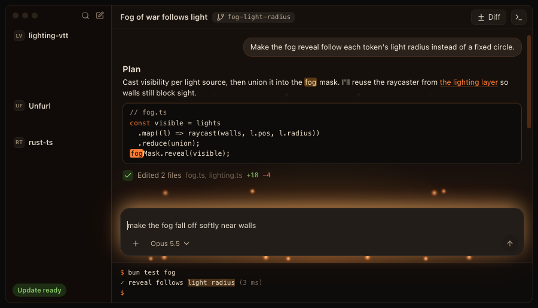
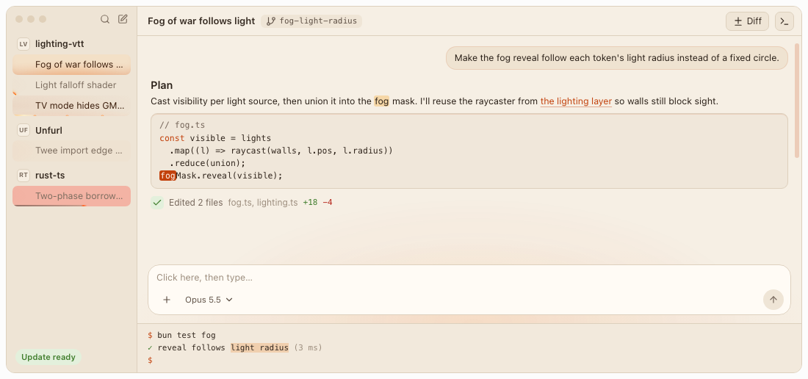

# Torchlight

A firelit theme for [T3 Code](https://t3.codes): soot-brown panels, warm ivory text, and orange accents. Focus the composer and its border flickers like a torch. Embers rise as you write, while sparks follow active threads through the sidebar.

Includes a dark palette and a parchment-like light variant, with matching terminal colors and reduced-motion support. All effects are CSS; no external images, fonts, or services are needed.




*Illustrative preview scenes. The live layout depends on your T3 Code version.*

## Install

```sh
curl -fsSL https://raw.githubusercontent.com/HitBox38/t3-torchlight-theme/main/torchlight.json -o torchlight.json
t3 theme set torchlight.json
```

T3 applies Torchlight to connected desktop and web clients. The theme defaults to dark and includes a light variant; choose your appearance in Settings → Appearance.

To switch back, pick another theme in the theme picker or run:

```sh
t3 theme set t3-chat
```

### Let your agent install it

Paste this into a T3 Code thread:

> Install the Torchlight theme from https://github.com/HitBox38/t3-torchlight-theme. Follow the "Instructions for agents" section of its README.

### Instructions for agents

1. Download `https://raw.githubusercontent.com/HitBox38/t3-torchlight-theme/main/torchlight.json`.
2. If the `t3` command is available, run `t3 theme set <path to torchlight.json>`.
3. Otherwise, read the theme guide with `t3_theme_read`, then call `t3_theme_set` with `themeId: "torchlight"` and the downloaded JSON object as `theme`.
4. Install the file as provided. It contains both appearances and the complete animations.

## Requirements

- A recent T3 Code build with custom themes, such as the November 2026 Nightly.
- Desktop or web. T3's mobile app does not use custom themes.

## Notes

- Focus the composer and type to see the firelight and drifting embers.
- Sidebar effects respond to hover, the selected thread, and thread activity.
- The theme reduces its decorative motion when the system requests reduced motion.
- Some effects follow T3's UI selectors. Future layout changes may require CSS updates.

## Change the theme yourself

- `palette.json` contains the theme metadata and both color palettes.
- `theme.css` contains the styles and animations.
- `build.py` combines them into the installable `torchlight.json` and checks T3's 20,000-character CSS limit.

After editing the sources, rebuild and install:

```sh
python3 build.py
python3 build.py --check
t3 theme set torchlight.json
```

Python 3 is only needed to rebuild. Installing the published JSON requires no build tools or dependencies.

## License

[MIT](LICENSE)

Repository packaging follows the [Nyx theme](https://github.com/Deepusleepy/t3-nyx-theme): a ready-to-install JSON file, agent installation instructions, editable sources, and previews.
